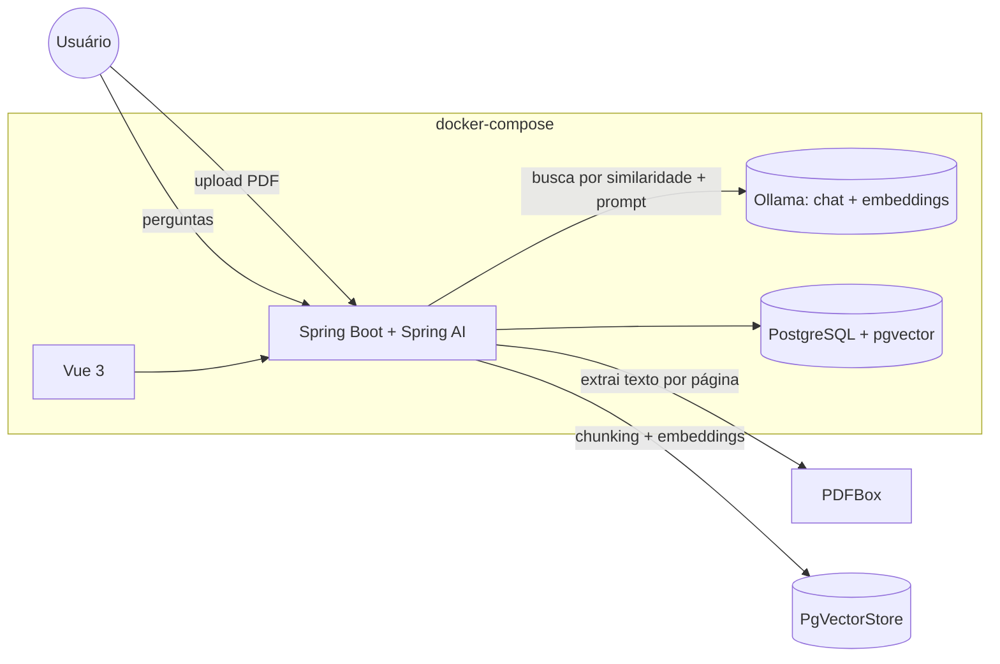

# assistente-de-licitacoes-ia

Assistente que lê um edital de licitação em PDF, permite perguntar sobre ele em linguagem natural (com a página de origem citada em cada resposta), extrai um resumo estruturado (objeto, valor estimado, modalidade, prazos, documentos exigidos) e roda um conjunto de perguntas de teste contra o edital para avaliar a qualidade das respostas.

## Funcionalidades

- Upload de edital em PDF, com extração de texto **por página** e indexação assíncrona (Java 21 Virtual Threads) em um banco vetorial
- Perguntas e respostas sobre o conteúdo do edital via RAG (*Retrieval-Augmented Generation*), com **citação de página garantida estruturalmente** — não depende do modelo formatar a citação corretamente
- Resposta explícita de "não encontrado" quando a pergunta não tem base no edital, em vez de o modelo inventar uma resposta
- Extração de resumo estruturado em uma única chamada (objeto, valor estimado, modalidade, prazos, documentos de habilitação exigidos)
- Avaliação determinística: cadastro de pares pergunta/resposta esperada e execução em lote contra o edital, com resultado passou/falhou por caso

## Arquitetura



O upload dispara a ingestão em segundo plano (virtual thread): o PDF é extraído página a página, cada página é dividida em trechos com sobreposição (para não cortar uma frase relevante na fronteira entre dois trechos) e cada trecho entra no `PgVectorStore` já associado, via metadado, ao documento e à página de origem.

Uma pergunta busca os trechos mais similares **apenas dentro do documento perguntado** (filtro por `documentoId`), monta um prompt que instrui o modelo a responder somente com base nesses trechos, e devolve ao usuário as páginas citadas — lidas diretamente dos metadados dos trechos recuperados, não extraídas por regex da resposta do modelo.

## Stack

| Camada | Tecnologia |
| --- | --- |
| Backend | Spring Boot 3, Java 21 com **Virtual Threads** para a ingestão assíncrona |
| IA | **Spring AI 1.0**, Ollama (chat + embeddings), `PgVectorStore` |
| Extração de PDF | Apache PDFBox |
| Banco | PostgreSQL + **pgvector** |
| Frontend | Vue 3, Vite, TypeScript, Tailwind CSS |
| Documentação da API | springdoc-openapi (Swagger em `/swagger-ui.html`) |
| Testes | JUnit 5, Testcontainers (Postgres com pgvector **e Ollama real**), Vitest |
| Infra | Docker Compose, GitHub Actions |

## Como rodar

Pré-requisitos: Docker e Docker Compose. O primeiro `up` baixa as imagens do Ollama e os modelos configurados — pode levar alguns minutos.

```bash
cp .env.example .env
docker compose up --build
```

- Frontend: http://localhost:5173
- API: http://localhost:8080 — documentação em http://localhost:8080/swagger-ui.html

Os modelos padrão (`llama3.2:1b` para chat, `nomic-embed-text` para embeddings) são escolhidos por serem pequenos o bastante para rodar em CPU sem GPU dedicada. Modelos maiores podem ser configurados via `OLLAMA_CHAT_MODEL` no `.env`, trocando velocidade por qualidade de resposta.

### Rodando os testes

```bash
cd backend
mvn verify   # unitários + integração (Testcontainers: Postgres com pgvector e um Ollama real)
```

```bash
cd frontend
npm ci
npm run test
npm run build
```

## Decisões técnicas

- **Esquema do banco vetorial gerenciado pelo Spring AI, não pelo Flyway**: em todo o resto deste portfólio, o Flyway é o único dono do esquema. Aqui, a tabela que guarda os trechos e seus embeddings (`trecho`) é criada e versionada pelo próprio `PgVectorStore` (`initialize-schema: true`) — uma exceção deliberada, porque o formato interno dessa tabela (dimensão do vetor, tipo de índice) é parte do contrato da biblioteca, não do domínio da aplicação. O restante do esquema (documento, resumo, conversa, mensagem, avaliação) continua em migrations Flyway normais.
- **Citação de página por proveniência da busca, não por parsing da resposta**: o prompt pede ao modelo que cite a página entre colchetes, mas essa citação textual nunca é a fonte de verdade — as páginas retornadas ao usuário vêm sempre da lista de trechos efetivamente recuperados na busca vetorial. Isso torna a citação confiável mesmo se o modelo esquecer de citar ou citar errado no texto.
- **Resposta "não encontrado" explícita**: quando a busca não encontra nenhum trecho acima do limite mínimo de similaridade, a pergunta nem chega a ser enviada ao modelo — evita que o modelo tente responder sem contexto e alucine.
- **Avaliação determinística (contém-texto normalizado), não um LLM-juiz**: cada caso de teste compara a resposta obtida com a esperada por correspondência de substring após normalizar acentos, pontuação e espaços. É mais barato, instantâneo e 100% reprodutível do que pedir a outro modelo para julgar a resposta — ao custo de não capturar respostas corretas com redação muito diferente da esperada. Avaliação por LLM-juiz é um roteiro de evolução natural, não implementado agora.
- **Testcontainers com um Ollama real nos testes de integração**: em vez de mockar o cliente de IA, o teste de ponta a ponta sobe um container Ollama real e baixa modelos minúsculos (`qwen2:0.5b` para chat, `nomic-embed-text` para embeddings) só para o teste — mais lento que um mock, mas é a única forma de validar que o pipeline de ingestão, busca e geração funciona de verdade, não apenas que os tipos se encaixam.

### O que este projeto demonstra

Uso de IA generativa aplicado com engenharia — não só "chamar uma API de LLM", mas desenhar o sistema para que a parte mais importante de confiabilidade (a citação da fonte) não dependa do modelo se comportar bem.

## Roteiro (próximas evoluções)

- [ ] OCR para editais em PDF escaneado (sem texto selecionável)
- [ ] Avaliação por LLM-juiz, como complemento à checagem determinística
- [ ] Busca híbrida (vetorial + full-text) para perguntas com termos muito específicos (números de lei, siglas)
- [ ] Comparação de custo/qualidade entre modelo local (Ollama) e um modelo externo
- [ ] Importação automática de editais a partir do PNCP (Portal Nacional de Contratações Públicas)
